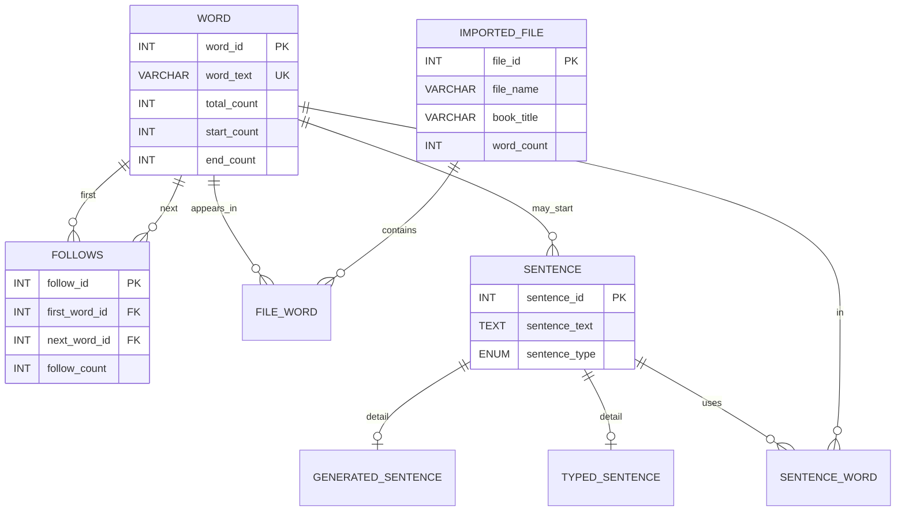

# Sentence Builder – Entity Relationship Overview

**Authors:** Umair Malik (schema), Ahmed Sherwani (import), Nirav Rohra (integration)  
**Database:** `sentence_builder` (MySQL 8)



Apply with:

```bash
mysql -u root -p < db/schema.sql
```

Or point `DATABASE_URL` / `DATABASE_USERNAME` / `DATABASE_PASSWORD` at AWS RDS (Ahmed).
