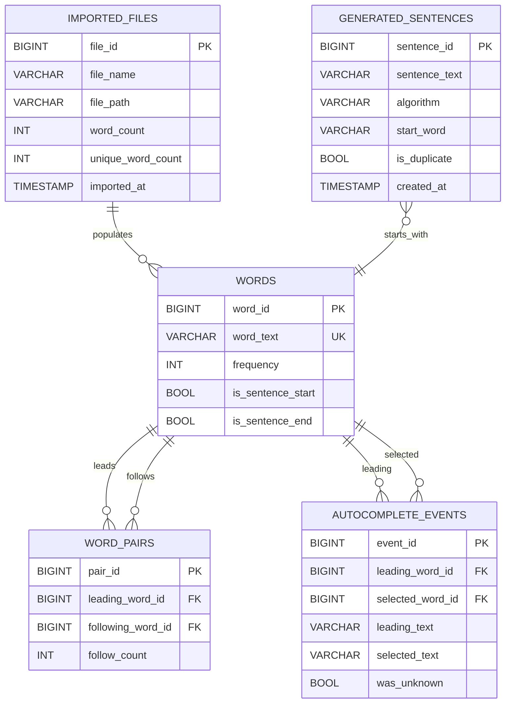

# Sentence Builder – Entity Relationship Overview

**Author:** Nirav Rohra  
**Date:** 2026-10-16  
**Database:** `sentence_builder` (MySQL 8)



## Relationships

| From | To | Cardinality | Meaning |
|------|-----|-------------|---------|
| `words` | `word_pairs` | 1:N (as leading) | A word may lead many follower pairs |
| `words` | `word_pairs` | 1:N (as following) | A word may follow many leaders |
| `words` | `autocomplete_events` | 1:N | Suggestion acceptances / unknown-word adds |
| `imported_files` | corpus | logical | Import history; tokens land in `words` / `word_pairs` |
| `generated_sentences` | corpus | logical | Generated text can be fed back into the corpus |

Apply the schema with:

```bash
mysql -u root -p < db/schema.sql
```

Or start the Docker MySQL service (see README) which runs this script on first boot.
